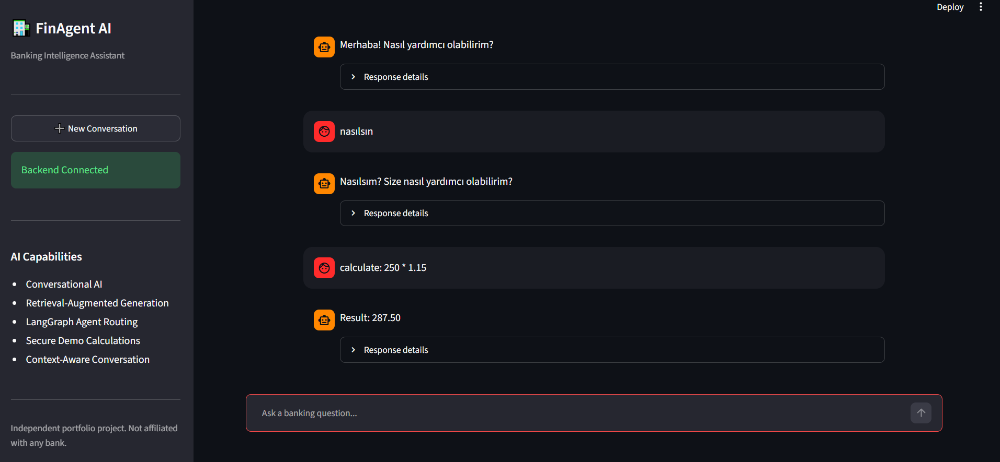
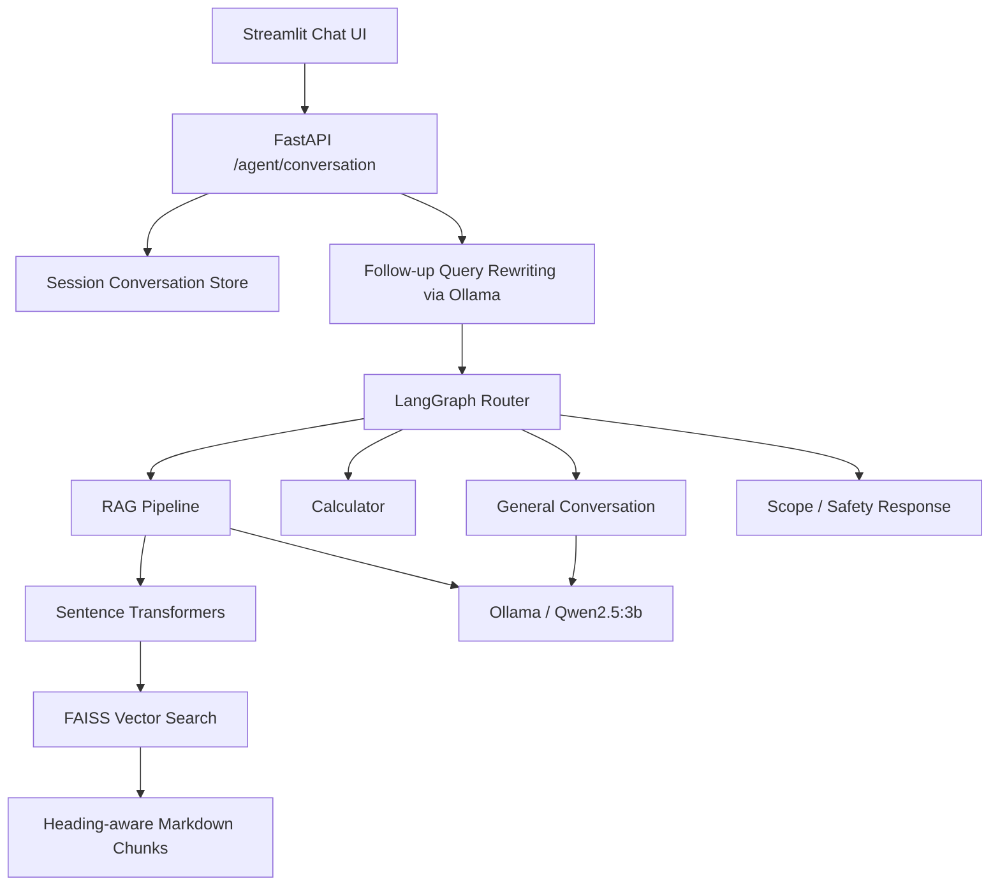

# FinAgent AI

## A Context-Aware Banking Conversational AI Assistant

### Python · FastAPI · LangGraph · RAG · FAISS · Sentence Transformers · Ollama · Qwen2.5 · Streamlit · Pytest**

FinAgent AI is an independent AI engineering portfolio project exploring **retrieval-augmented generation (RAG)**, **agentic workflows**, and **context-aware conversations** in a fictional banking environment. It combines a local language model with source-based retrieval, a LangGraph workflow, a small calculation tool, and a Streamlit chat interface.

> **Demo and research project.** All banking product documents are fictional. FinAgent AI is not affiliated with any bank or financial institution. Do not submit personal, financial, or authentication data.

## Application Preview



*Local Streamlit application with conversational responses, tool routing, and expandable response details.*

## Key Features

- **Document-grounded Q&A:** Searches fictional banking documents using Sentence Transformers and FAISS before generating an answer with Qwen2.5 through Ollama.
- **Heading-aware ingestion:** Splits Markdown documents into topic-focused sections, retaining source and chunk identifiers.
- **Relevance filtering:** Applies a configurable cosine-similarity threshold to exclude low-scoring retrieved chunks.
- **LangGraph workflow:** Routes requests to RAG, basic arithmetic, a conversational response, or a scope-handling branch. Routing currently relies on deterministic rules, not a fully autonomous agent.
- **Multi-turn conversations:** Maintains temporary per-session history and rewrites contextual follow-up questions into standalone queries.
- **Calculator tool:** Supports explicitly formatted `calculate:` expressions for basic arithmetic without using Python `eval()`.
- **Streamlit UI:** Provides a chat interface, new-conversation control, backend health indicator, source references, selected route, and observed response time.
- **Automated testing:** Includes tests for retrieval, routing, conversation storage, API behavior, and core utilities.

## System Architecture



### RAG workflow

1. Load fictional banking Markdown documents from `data/sample_docs/`.
2. Segment documents by Markdown headings and preserve source metadata.
3. Encode each chunk with `sentence-transformers/all-MiniLM-L6-v2`.
4. Store embeddings in an in-memory FAISS index.
5. Embed the user question, retrieve the nearest chunks, and filter them by similarity.
6. Provide retrieved text as context to `qwen2.5:3b` via Ollama and return the generated response plus retrieved source names.

**Note:** The returned source list identifies *retrieved context*, not independently verified citations. The project does not yet guarantee answer faithfulness or resistance to prompt injection.

## Technology Stack

| Layer | Technologies |
| --- | --- |
| API | Python, FastAPI, Pydantic, Uvicorn |
| Orchestration | LangGraph |
| Local language model | Ollama, Qwen2.5:3b |
| Embeddings | Sentence Transformers, all-MiniLM-L6-v2 |
| Retrieval | FAISS, NumPy, heading-aware Markdown chunking |
| Frontend | Streamlit, Requests |
| Testing | Pytest, FastAPI TestClient |
| Version control | Git, GitHub |

## Local Setup

### Requirements

- Python 3.10 or a compatible version
- Git
- [Ollama](https://ollama.com/download) installed locally
- Enough disk space and available memory to run the Qwen2.5:3b model

### 1. Clone and create the virtual environment

```bash
git clone https://github.com/Merdgn/finagent-ai.git
cd finagent-ai
python -m venv .venv
```

Activate the environment:

### Windows CMD

```bat
.venv\Scripts\activate.bat
```

### macOS / Linux

```bash
source .venv/bin/activate
```

### 2. Install Python dependencies

```bash
python -m pip install -r requirements.txt
```

### 3. Download the local model

```bash
ollama pull qwen2.5:3b
```

Make sure Ollama is running before sending requests.

### 4. Start the FastAPI backend

```bash
python -m uvicorn app.main:app --reload
```

- API: [Streamlit Interface](http://127.0.0.1:8000)
- Interactive API documentation: [Streamlit Interface](http://127.0.0.1:8000/docs)
- Health check: [Streamlit Interface](http://127.0.0.1:8000/health)

### 5. Start the Streamlit frontend

In a **second terminal**, activate the same virtual environment and run:

```bash
python -m streamlit run frontend/app.py
```

Open [Streamlit Interface](http://localhost:8501)

The frontend expects the API at `http://127.0.0.1:8000` by default. To use another backend address, set the `FINAGENT_API_URL` environment variable before launching Streamlit.

## API Endpoints

| Method | Endpoint | Description |
| --- | --- | --- |
| `GET` | `/` | Project metadata |
| `GET` | `/health` | Basic backend health check |
| `POST` | `/chat` | Direct document-grounded RAG |
| `POST` | `/agent/chat` | LangGraph-routed request |
| `POST` | `/agent/conversation` | Session-aware chat with follow-up rewriting |

Example conversation request:

```json
{
  "session_id": "550e8400-e29b-41d4-a716-446655440000",
  "question": "How can I open a savings account?"
}
```

Reuse the same UUID for a follow-up question such as `What about its interest rate?`. The API returns an answer, route, retrieved source list, and standalone reformulation of the question.

## Retrieval Evaluation

The initial evaluation uses **two fictional documents**, **15 heading-aware chunks**, and **six hand-crafted questions**: five in-domain questions and one out-of-domain question.

| Metric | Observed result |
| --- | --- |
| Hit Rate@3 | 100% (5/5 in-domain questions) |
| MRR@3 | 1.0000 |
| Mean retrieval latency | 10.23 ms |
| Out-of-domain rejection | 100% (1/1 question) |

**Evaluation configuration:** `top_k=3`, similarity threshold `0.30`, `all-MiniLM-L6-v2` embeddings, FAISS search.

The latency measurement includes question embedding and FAISS search, **not** model startup or generated-answer latency. These development-set scores do **not** establish generalization to unseen questions or production traffic.

- Dataset: [`data/evaluation/retrieval_cases.json`](data/evaluation/retrieval_cases.json)
- Script: [`scripts/evaluate_retrieval.py`](scripts/evaluate_retrieval.py)
- Report: [`reports/retrieval_evaluation.md`](reports/retrieval_evaluation.md)

Run the evaluation:

```bash
python -m scripts.evaluate_retrieval
```

## Testing

Run the automated test suite:

```bash
python -m pytest -v
```

**Most recent locally reported result: 39 passing tests**, covering API endpoints, RAG components, session storage, conversation rewriting, and LangGraph routing. Additional greeting regression tests have been proposed but their final result has not been confirmed in this README.

## Current Limitations

- Designed for **local experimentation**, not production banking use.
- The model runs on local Ollama; the Streamlit frontend alone is not a standalone hosted deployment.
- The router has rule-based behavior and may misclassify unfamiliar or ambiguous inputs.
- Conversation history is temporary, per process, and not protected by user authentication or access control.
- Retrieved sources are not independently validated as supporting each claim.
- The six-question retrieval benchmark is too small for robust performance claims.
- Prompt instructions and minimal validation are not sufficient security controls for real financial information.

## Roadmap

- [x] FastAPI API foundation and health checks
- [x] Markdown ingestion, embeddings, and FAISS search
- [x] RAG question answering with Ollama
- [x] Heading-aware chunking and initial retrieval evaluation
- [x] LangGraph workflow and basic calculation tool
- [x] Temporary conversation memory and follow-up rewriting
- [x] Streamlit chat interface
- [ ] Broader intent classification and routing evaluation
- [ ] Independent retrieval and answer-quality benchmark
- [ ] Authentication, session authorization, and privacy safeguards
- [ ] Prompt-injection and security regression tests
- [ ] Docker packaging, deployment configuration, and hosted demo

## Disclaimer

FinAgent AI is an independent educational and portfolio project built with fictional sample data. It is not associated with TEB, TEB Arf, or any other financial institution, and must not be used for live banking transactions, financial advice, or processing sensitive information.
